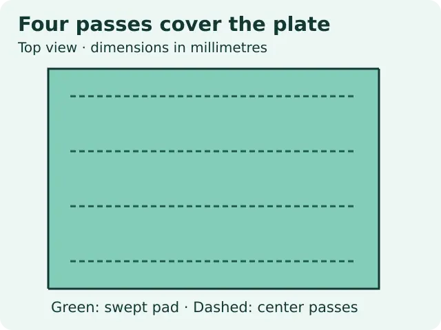
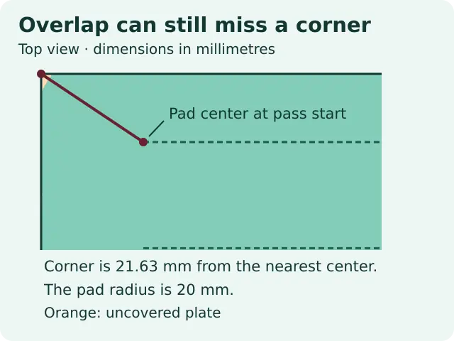

# Robotic sanding: check raster coverage in Python

Estimate which points on a flat rectangular workpiece an ideal round pad could touch. This project is an offline geometry exercise. It does not control a robot, predict material removal, or define a safe sanding process.

Full lesson: [Robotic Sanding: Check Raster Coverage in Python](https://wifarobotics.com/learn/robotic-sanding-automation/).

## Start with an empty computer

1. Install Python 3.10 or newer using the [Python setup guide](https://docs.python.org/3/using/index.html).
2. On this repository page, choose **Code**, then **Download ZIP**. Extract the ZIP and open a terminal in the extracted folder, where you can see `sanding_coverage.py`. If you have Git, you can instead clone this repository and open the cloned folder.
3. Run `python3 --version` on macOS or Linux, or `py -3 --version` on Windows. No packages, GPU, or robot are required.

Run these from the repository root. On Windows, replace `python3` with `py -3`.

```sh
python3 sanding_coverage.py examples/covered.json
python3 sanding_coverage.py examples/missed-corners.json
python3 sanding_coverage.py examples/missed-stripes.json
python3 sanding_coverage.py examples/sampling-blind-spot.json
python3 -m unittest discover -s tests -v
```

| Example | Passes | Ideal full coverage | Clearance | Sampled coverage |
| --- | ---: | --- | ---: | ---: |
| Covered | 4 | Yes | +7.194 mm | 600 / 600 |
| Missed corners | 4 | No | −1.633 mm | 9588 / 9600 |
| Missed stripes | 3 | No | −6.000 mm | 480 / 600 |
| Sampling blind spot | 4 | No | −1.633 mm | 40 / 40 |

Clearance means pad radius minus the largest distance anywhere on the plate to the closest pass. A negative value identifies uncovered geometry; zero means ideal contact at exactly the disk edge. `witness_mm` is one point that attains the worst distance. Sample coverage only counts grid cell centers; it cannot certify that every point is covered.

Make a copy of an example JSON before editing it. All dimensions are in millimetres. Length is the dimension along each pass. The first and last center lines are each `side_inset_mm` from a long edge, and passes stop `end_inset_mm` from the short edges. The planner distributes passes evenly with actual pitch no larger than `max_pitch_mm`. A negative `interior_overlap_percent` indicates a gap between adjacent swaths away from the pass ends.

## Troubleshooting

* If Python cannot open the file, confirm the terminal is in the extracted project root.
* If the program reports missing fields, compare your file with an example. Use a decimal point and remove trailing commas. Only insets can be zero.
* If the sample limit is hit, increase `sample_step_mm`. This only changes the sample estimate, not the exact clearance.
* If the pitch is smaller than you entered, remember the input is a maximum. The planner divides the span into equal gaps.
* A narrow miss can still display 100% sampled coverage. Use `full_coverage_ideal` and inspect the witness.

## Files

`sanding_coverage.py` implements the planner and CLI. `examples/` contains the four independent inputs. `tests/test_sanding.py` includes a separate closest point projection over every pass for comparison. The editable diagrams in `diagrams/` can be regenerated with `python3 diagrams/draw.py`; the WebPs are optimized exports of those SVGs.





The [Noether raster planner documentation](https://ros-industrial.github.io/noether/group__raster__planners.html) shows how real surface paths are organized into raster segments. The [Robotiq sanding kit documentation](https://robotiq.com/products/sanding-kit) gives hardware context for force and trajectory control. Neither was used to set the synthetic test values.
